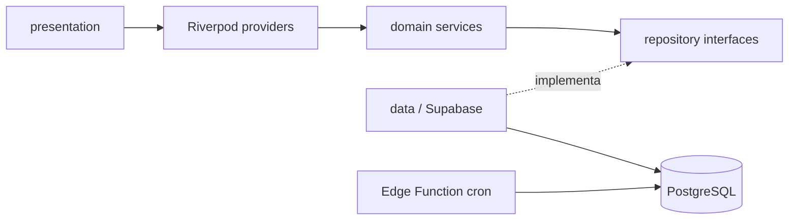

# Plan de implementación — Spec 01: App de Finanzas Personales (Flutter + Supabase)

## Objetivo
Implementar el MVP descrito en `docs/specs/01_app_finanzas.md.md`: cuentas eje, bolsillos, tarjetas de crédito, ingreso por NLP, pagos recurrentes, alertas, dashboard global y cierre fiscal. Se sigue `AGENTS.md` y la constitución: lógica pura separada de la UI, TDD, 100% de tests en verde, verificación visual con Chrome DevTools MCP, y código en inglés con UI en español.

## Decisiones tomadas
| Tema | Decisión |
|---|---|
| Flutter SDK | Lo instala el usuario. No procedo sin `flutter --version` operativo. |
| Supabase | Proyecto real conectado desde el inicio. |
| Plataforma | Web/PWA primero (verificable en Chrome). Android/iOS quedan fuera de este plan. |
| Pagos recurrentes | Los ejecuta Supabase (Edge Function + cron). |
| Cierre fiscal | Exportar JSON/CSV, borrar transacciones y dejar el saldo actual como saldo inicial, con doble confirmación. |

> [!WARNING]
> `mcp_config.json` contiene un `SUPABASE_ACCESS_TOKEN` real (`sbp_...`) y un `SUPABASE_PROJECT_ID` con un `<` sobrante. Recomiendo rotar el token y moverlo a variables de entorno antes de subir el repo a GitHub. El `.gitignore` no lo protege.

## Resoluciones aprobadas (2026-10-07) — PLAN APROBADO
1. **Autenticación:** registro y login con correo y contraseña (Supabase Auth).
2. **Moneda:** solo COP, montos como enteros.
3. **Bolsillos:** CRUD completo (se permiten más de los 4 iniciales).
4. **Saldos iniciales:** pantalla de configuración inicial (onboarding) para cuentas, bolsillos y tarjetas.
5. **NLP:** RegEx con alias y pantalla de confirmación editable antes de guardar.
6. **Notificaciones (Web):** centro de alertas in-app en el dashboard.
7. **Recordatorios de tarjeta:** alertas 1 y 2 días antes, a la hora que defina el usuario (se guarda como preferencia).
8. **Abonos a tarjeta:** transacción habilitada; descuenta de la cuenta eje y restaura el cupo.

## Preguntas abiertas (históricas, ya resueltas arriba)
> [!IMPORTANT]
> Necesito estas respuestas, porque la spec no las define y las reglas prohíben asumir:
> 1. **Autenticación:** la spec menciona GoTrue. ¿Usuario único con email/contraseña? ¿Habrá registro o solo un usuario fijo? Esto determina las políticas RLS.
> 2. **Modelo de dinero:** propongo guardar los montos como enteros en COP (sin decimales) para evitar errores de punto flotante. ¿Acepto que el MVP sea solo COP? La spec incluye un campo "Moneda" en la tarjeta.
> 3. **Bolsillos:** ¿los 4 bolsillos (Personal, Graficolor, Apartamentos, Favores) vienen sembrados y el usuario puede crear más? Propongo CRUD básico de bolsillos.
> 4. **Saldos iniciales:** ¿cómo se cargan los saldos por cuenta y bolsillo la primera vez? Propongo una pantalla de configuración inicial.
> 5. **NLP:** propongo un parser determinista con RegEx y alias configurables (por ejemplo "rappi" → TC RappiCard, "graficolor" → bolsillo Graficolor). Ante ambigüedad, la UI muestra una confirmación editable antes de guardar. ¿Estás de acuerdo?
> 6. **Notificaciones:** `flutter_local_notifications` no soporta Web. Para Web propongo alertas in-app (banner y lista en el dashboard), y las notificaciones del dispositivo quedan para la fase móvil. ¿Aceptas?
> 7. **Recordatorios de tarjeta:** la spec dice "2 y 1 días antes". Los criterios de aceptación dicen "24 y 48 horas". Propongo interpretarlos como 1 y 2 días calendario, con hora de aviso configurable (por defecto 8:00 a. m., America/Bogotá). ¿Correcto?
> 8. **Tarjetas:** "Cupo Disponible" se actualiza con los gastos. ¿Los pagos a la tarjeta (abonos) están dentro del MVP? Propongo un tipo de transacción "abono a tarjeta" que descuenta de una cuenta eje y repone el cupo.

## Dependencias a autorizar (únicas)
| Paquete | Justificación |
|---|---|
| `supabase_flutter` | Auth y acceso a PostgreSQL. |
| `flutter_riverpod` | Gestión de estado (definida en la spec). |
| `flutter_test` | Tests (viene con el SDK). |
| `mocktail` (dev) | Dobles de prueba para los repositorios. Opcional. |
| `csv` | Exportación CSV. Es la alternativa a generarlo a mano. |
| `intl` | Formato COP y fechas en español. |

`petitparser` **no** se usa: RegEx nativo de Dart es suficiente para el NLP del MVP. `flutter_local_notifications` se difiere (ver pregunta 6).

## Arquitectura
```
lib/
  domain/        # Dart puro, sin Flutter ni Supabase
    models/      # Account, Pocket, CreditCard, Transaction, RecurringPayment, Alert
    services/    # NlpParser, BalanceCalculator, RecurringPaymentProcessor,
                 # AlertScheduler, FiscalCloseService
    repositories/# interfaces abstractas
  data/          # SupabaseXRepository, DTO mappers
  presentation/  # screens, widgets, riverpod providers
supabase/
  migrations/    # esquema SQL + RLS
  functions/     # process-recurring-payments (Edge Function)
test/
  domain/        # tests unitarios de la lógica pura
```



## Fases de ejecución (TDD en cada una)

### Fase 0 — Preparación *(requiere Flutter instalado)*
- `flutter create` con soporte web en la raíz, y `flutter pub add` de las dependencias autorizadas.
- Crear `supabase/migrations/0001_init.sql`: tablas `accounts`, `pockets`, `credit_cards`, `transactions`, `recurring_payments`, `alerts`. Todas llevan `user_id` y RLS activo. Los montos son `bigint`.
- Aplicar la migración al proyecto real. **Pido confirmación antes de ejecutarla.**

### Fase 1 — Dominio puro (tests primero)
- **BalanceCalculator:** el saldo de la cuenta es la suma de sus bolsillos. Mover dinero entre bolsillos de la misma cuenta no cambia el total. El patrimonio neto es la suma de las cuentas. Los pasivos (tarjetas) se muestran separados.
- **NlpParser:** extrae monto (`15000`, `500.000`, `$500000`), signo (gasto, o ingreso con "ingresaron/abono/recibí"), origen (cuenta o tarjeta por alias), bolsillo y descripción. Casos límite: monto ausente, origen desconocido, varias coincidencias, frases vacías.
- **Gasto con tarjeta:** registra el gasto en el bolsillo y reduce el cupo disponible. Valida que el cupo no quede negativo.
- **RecurringPaymentProcessor:** calcula la próxima fecha de cobro (incluye fin de mes y años bisiestos). Ejecuta los cobros vencidos de forma idempotente.
- **AlertScheduler:** genera alertas 48 h y 24 h antes de cada vencimiento (suscripciones y límite de pago de tarjeta). No genera duplicados.
- **FiscalCloseService:** genera el JSON/CSV anual y calcula los saldos iniciales del nuevo año.

### Fase 2 — Capa de datos
- Repositorios Supabase que implementan las interfaces, con mappers y validación en los límites (Principio 5).
- Operaciones compuestas (gasto + reducción de cupo) en una función RPC de PostgreSQL, para que sean atómicas.
- Edge Function `process-recurring-payments`, programada con `pg_cron` o el scheduler de Supabase, reutilizando la misma regla de cálculo.
- Tests de integración de repositorios con dobles de prueba.

### Fase 3 — Presentación (Web)
- Login. Configuración inicial de cuentas, bolsillos y tarjetas.
- **Dashboard global:** patrimonio neto, saldos por cuenta y bolsillo, tarjetas con deuda y fechas de corte y límite de pago, y alertas activas.
- **Ingreso rápido por frase:** campo de texto, vista previa editable de lo interpretado y confirmación.
- **Suscripciones:** lista y formulario (método de pago, bolsillo, automático o manual).
- **Cierre fiscal:** exportar, doble confirmación y reseteo.
- Textos de UI en español y formato COP con `intl`.

### Fase 4 — Verificación visual
Ejecutar con `flutter run -d chrome` y usar Chrome DevTools MCP para: capturas en escritorio y móvil, cero errores de consola y flujo completo (frase → gasto → dashboard actualizado).

### Fase 5 — Consolidación
Actualizar `MEMORY.md` (estado, decisiones, aprendizajes) y generar el walkthrough.

## Plan de verificación
- **Automática:** `flutter analyze` sin hallazgos y `flutter test` con 0 fallos.
- **Visual:** capturas y consola limpia con Chrome DevTools MCP.
- **Criterios de aceptación de la spec:** cada uno tiene un test dedicado (NLP, gasto con tarjeta y cupo, alertas a 24 h y 48 h, dashboard con pasivos separados).

## Fuera de alcance
Android/iOS, notificaciones del dispositivo, histórico de tarjetas y multimoneda.
