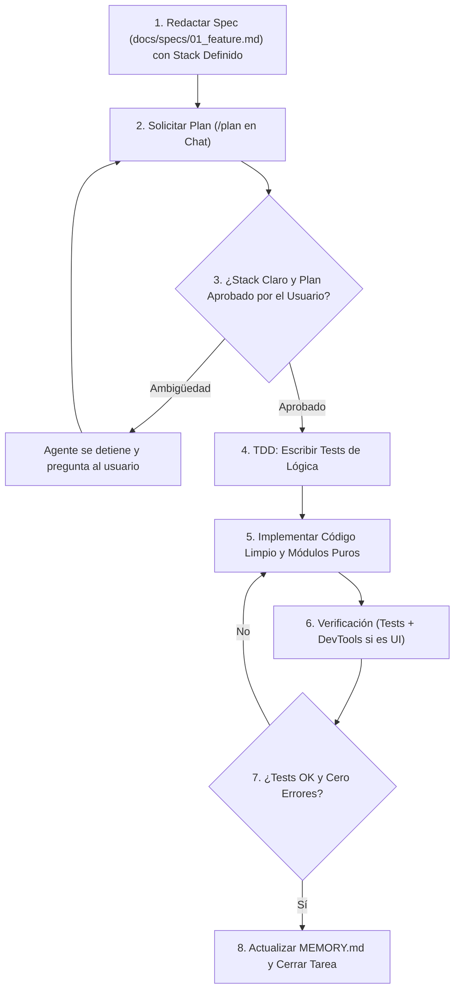

# Guía de Uso — Plantilla Base (Antigravity SDD)

Bienvenido a la **plantilla-base** diseñada específicamente para trabajar con **Google Antigravity** bajo la metodología **Spec-Driven Development (SDD)**.

El objetivo de esta plantilla es permitirte iniciar cualquier proyecto de software (aplicación web, móvil, API o herramienta interactiva) con una arquitectura limpia, modular y con control de calidad absoluto. En esta metodología, **nunca se escribe código sin un plan previo aprobado**.

---

## 1. Stack Dinámico y Arquitectura Agnóstica

> [!IMPORTANT]
> **El Stack Tecnológico NO está predefinido en esta plantilla.**
> - **Origen de la Verdad:** Antes de planificar o escribir código, el agente lee obligatoriamente la especificación activa (`docs/specs/`) para conocer el stack específico del proyecto. Si no está definido o es ambiguo, el agente se detiene y pregunta al usuario.
> - **Regla de Dependencias:** Queda prohibido instalar paquetes, SDKs o inicializar frameworks (ej. `npm`, `flutter`, `pip`, `cargo`) sin autorización explícita en un plan previamente aprobado.
> - **Estructura Base Agnóstica:**
>   - `docs/` (Constitución, especificaciones de requerimientos y arquitectura).
>   - Directorio de código fuente (`src/`, `lib/`, `app/`, etc., según el framework o lenguaje elegido).
>   - Directorio de pruebas (`tests/`, `__tests__/`, etc.).

---

## 2. Cómo Clonar o Duplicar esta Plantilla

Cuando vayas a crear un nuevo proyecto:

1. **Copia o duplica esta carpeta** en tu directorio de trabajo con el nombre de tu nuevo proyecto:
   ```bash
   # En Windows PowerShell:
   Copy-Item -Recurse -Path "c:\Users\User\Desktop\developing\plantilla-base-web" -Destination "c:\Users\User\Desktop\developing\mi-nuevo-proyecto"
   ```
2. **Abre la nueva carpeta** en tu editor con Antigravity (Antigravity IDE o VS Code con extensión Antigravity).
3. **Inicializa tu repositorio Git:**
   ```bash
   git init
   git add .
   git commit -m "chore: initial project setup from antigravity-sdd-template"
   ```

---

## 3. Dónde y Cómo Configurar las Claves de los MCPs

El archivo de configuración principal de servidores MCP es [mcp_config.json](file:///mcp_config.json) en la raíz del proyecto (también compatible de forma global en `~/.gemini/config/mcp_config.json`).

Abre [mcp_config.json](file:///mcp_config.json) y sustituye las etiquetas `<TU_...>` por tus credenciales reales según las herramientas que utilice tu proyecto:

### 3.1. Chrome DevTools (Local - Sin claves)
- **Función:** Permite al agente renderizar interfaces web en un navegador real, inspeccionar el DOM, tomar capturas de pantalla, revisar la consola y verificar el diseño responsive.
- **Configuración:** Viene preconfigurado mediante `npx -y chrome-devtools-mcp@latest --no-usage-statistics`. No requiere API keys.

### 3.2. Context7 (Remoto)
- **Función:** Proporciona documentación actualizada y contexto especializado de librerías y tecnologías modernas.
- **Dónde obtener la clave:** En tu panel de Context7 (https://context7.com).
- **Variable a rellenar:** `"CONTEXT7_API_KEY": "tu-api-key-aqui"` dentro de `"headers"`.

### 3.3. GitHub (Local)
- **Función:** Gestión de issues, pull requests, lectura y escritura de repositorios remotos.
- **Dónde obtener el token:** GitHub > Settings > Developer Settings > Personal Access Tokens (con permisos `repo`).
- **Variable a rellenar:** `"GITHUB_PERSONAL_ACCESS_TOKEN": "ghp_..."` dentro de `"env"`.

### 3.4. Figma (Local)
- **Función:** Inspección de prototipos y componentes en Figma para extraer estilos, medidas exactas, colores y assets.
- **Dónde obtener el token:** Figma > Account Settings > Personal access tokens.
- **Variable a rellenar:** `"FIGMA_ACCESS_TOKEN": "figd_..."` dentro de `"env"`.

### 3.5. Supabase (Local)
- **Función:** Gestión de base de datos Postgres, autenticación y esquemas.
- **Dónde obtenerlos:**
  - Token de acceso: Supabase Dashboard > Account > Access Tokens.
  - Project ID: En la URL o configuración general de tu proyecto Supabase (`app.supabase.com/project/<project-id>`).
- **Variables a rellenar:**
  - `"SUPABASE_ACCESS_TOKEN": "sbp_..."`
  - `"SUPABASE_PROJECT_ID": "tu-project-id"`

> [!TIP]
> Recuerda nunca subir a Git tus claves reales. Si trabajas con repositorios públicos, añade `mcp_config.json` a tu `.gitignore` o utiliza la ruta global en tu máquina: `~/.gemini/config/mcp_config.json`.

---

## 4. Flujo de Trabajo SDD Paso a Paso con Antigravity

El flujo SDD garantiza que el agente nunca asuma requisitos ni tome decisiones de stack no autorizadas.



### Paso 4.1: Redactar la Primera Spec
Copia la plantilla [docs/specs/00_plantilla_spec.md](file:///docs/specs/00_plantilla_spec.md) a `docs/specs/01_nombre_del_modulo.md`. Asegúrate de completar la sección **Stack Tecnológico y Dependencias Autorizadas**:

```markdown
# Spec 01: Módulo de Autenticación y Perfil

## 1. Contexto y Objetivo
Implementar el flujo de inicio de sesión con correo y contraseña.

## 2. Stack Tecnológico y Dependencias Autorizadas
- **Lenguaje / Runtime:** TypeScript / Node.js 20
- **Framework:** Vanilla Web Components / Vite
- **Persistencia:** Supabase Client
- **Dependencias a Instalar:** `@supabase/supabase-js` (autorizado para interacción con auth).
- **Estructura:** `src/logic/` para auth-service, `src/ui/` para componentes, `tests/` para tests.

...
```

### Paso 4.2: Invocar el Comando `/plan`
En el chat de Antigravity, escribe:
> `/plan Implementa la especificación descrita en docs/specs/01_nombre_del_modulo.md siguiendo las directrices de AGENTS.md y constitution.md.`

Antigravity leerá la especificación, validará el stack definido, detallará las dependencias exactas a instalar (si las hay) y propondrá el plan de implementación paso a paso.

### Paso 4.3: Revisar y Aprobar el Plan
Revisa minuciosamente:
- ¿El stack propuesto coincide con lo que deseas?
- ¿Las dependencias a instalar son estrictamente necesarias?
- ¿La lógica de negocio se encuentra separada de la UI?
- ¿Están definidos los tests unitarios previos?
Autoriza la ejecución únicamente si el plan cumple todos los criterios.

### Paso 4.4: Ejecución Guiada por Tests (TDD)
El agente implementará las suites de pruebas para la lógica antes o en conjunto con los módulos puros, asegurando que todos los tests pasen al 100%.

### Paso 4.5: Verificación
- Si involucra interfaces web: el agente utilizará el MCP de Chrome DevTools para inspeccionar la pantalla, verificar responsividad y certificar que la consola esté libre de errores.
- Si involucra APIs o lógica pura: verificará que los tests unitarios e integrales reporten cero fallos.

### Paso 4.6: Actualización de `MEMORY.md`
Se actualiza [MEMORY.md](file:///MEMORY.md) con el estado consolidado, decisiones técnicas tomadas y siguientes hitos.

---

## 5. Estructura de Directorios Agnóstica

Mantén esta estructura desacoplada independientemente del stack elegido:

```
├── .agents/
│   ├── agents/          # Subagentes especializados de Antigravity
│   ├── commands/        # Atajos y scripts personalizados
│   └── skills/          # Habilidades y runbooks progresivos
├── docs/
│   ├── constitution.md  # 6 Principios innegociables (incluyendo stack dinámico)
│   └── specs/           # Especificaciones funcionales y técnicas (00_plantilla, 01_...)
├── [src|lib|app]/       # Código fuente según convención del lenguaje/framework
├── [tests|__tests__]/   # Suites de pruebas automatizadas
├── AGENTS.md            # Reglas de desarrollo y directrices del agente
├── MEMORY.md            # Memoria viva y persistente del proyecto
├── guia_de_uso.md       # Este manual de inicio
└── mcp_config.json      # Configuración de MCPs
```

---

## 6. Regla de Oro para el Desarrollador

> **"Si el stack o la función no está en la Spec, el agente se detiene y pregunta."**
> La especificación es la única fuente de verdad; el plan es el contrato de ejecución; el código es solo la consecuencia verificable.
